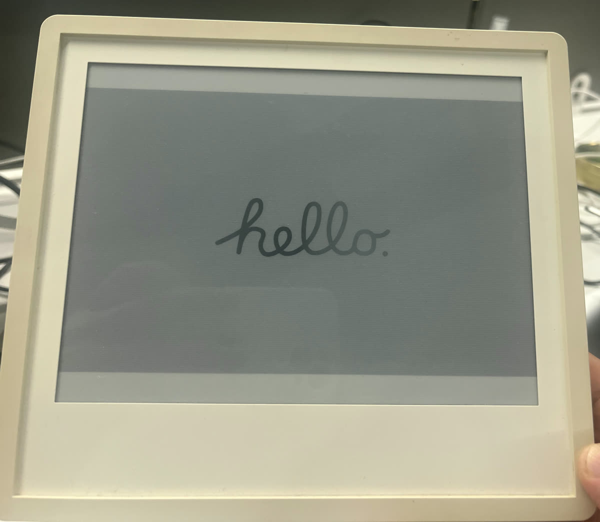
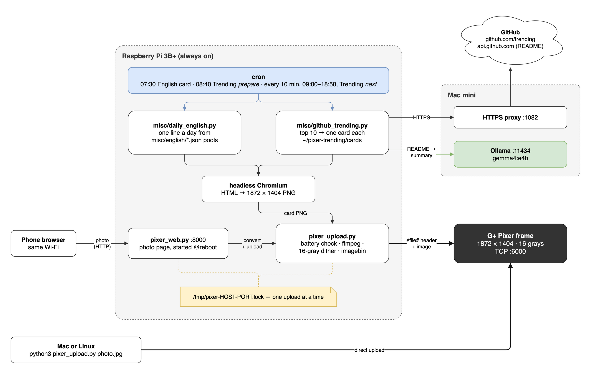

# PixerTool

Upload a photo from macOS or Linux straight to a **G+ Pixer** e-ink photo frame,
without the discontinued mobile app.

The Pixer app was pulled from the app stores, which left the frames unable to
receive new images. PixerTool reimplements the frame's local upload protocol —
recovered from the last published APK — as a single Python script with no
third-party dependencies.

```bash
python3 pixer_upload.py photo.jpg
```

<p align="center">
  
</p>

## The device

| | |
| --- | --- |
| Model | G+ Pixer (`com.gigazone.main.pixer`, app "Pixer!") |
| Panel | 7.8", 1872 x 1404, 16 grayscale levels |
| Wi-Fi | 802.11 b/g/n, 1T1R |
| Battery | Li-ion 8000 mAh |
| Regions | CN / US / JP / RU / TW |

A single image is 1,314,144 bytes on the wire. The frame's single-stream
802.11n radio has been measured at about 0.3 MB/s, so roughly four seconds per
upload. The frame acknowledges as soon as it holds the image and redraws its
panel afterwards.

## How it works

The frame runs a plain TCP server on `192.168.1.1:6000` while in direct mode.
An image is sent as a 1872 x 1404 (or 1404 x 1872) buffer of 16 grayscale
levels, two pixels packed per byte, preceded by a short ASCII header:

```text
#file#000801314144imagebin<1314144 bytes><#MOVE#d>
```

By default the image goes through the app's pipeline
exactly: integer Rec. 601 grayscale, a single-row error-diffusion dither
with a divisor of 17, and Java's truncate-toward-zero integer division. Those
steps are reproduced byte-for-byte here and covered by unit tests.

The full wire format is documented in [PROTOCOL.md](PROTOCOL.md).

## How the pieces fit

<p align="center">
  
</p>

`pixer_upload.py` is the only part that talks to the frame; everything else
makes an image and hands it over. On its own it runs from any Mac or Linux
computer. The setup above adds a small always-on computer, here a Raspberry Pi
3B+:

- `pixer_web.py` starts at boot, so phones on the same Wi-Fi can send photos.
- cron renders the [daily English card](#show-a-daily-english-card) at 07:30,
  prepares the [GitHub Trending](#rotate-github-trending) cards at 08:40, and
  shows the next Trending card every 10 minutes from 09:00 to 18:50. Both
  render HTML to a 1872 x 1404 PNG with headless Chromium.
- The Trending cards need GitHub, reached here through an HTTPS proxy, and an
  Ollama server to summarise each README; both run on a Mac mini.
- Every upload on the Pi takes the same lock file in `/tmp`, so a phone photo
  and a scheduled card never reach the frame at the same time.

The diagram's source is `misc/images/architecture.drawio`. Edit it in
[draw.io](https://www.drawio.com), then export the PNG:

```bash
/Applications/draw.io.app/Contents/MacOS/draw.io -x -f png -s 2 -b 24 \
  -o misc/images/architecture.png misc/images/architecture.drawio
```

## Requirements

- Python 3.9 or newer (no packages to install)
- `ffmpeg` and `ffprobe` on `PATH` — `brew install ffmpeg`
- A connection to the Pixer hotspot (for example, `Pixer 0939`) or a network that can reach the configured frame

## Usage

Wake the frame with one short press, connect to its Wi-Fi, then check that the
upload service is reachable:

```bash
python3 pixer_upload.py --probe
```

Convert an image without touching the frame, and keep the result for
inspection:

```bash
python3 pixer_upload.py photo.jpg --dry-run --output-bin photo.imagebin
```

Upload for real:

```bash
python3 pixer_upload.py photo.jpg
```

### Choose a dither

The panel shows 16 grays, so every image is quantized to 16 gray levels. The
default, `app`, reproduces the original app's grayscale and dither steps byte
for byte: an error diffusion that keeps a single row of pending error. Three
alternatives are available:

| `--dither` | Character |
| --- | --- |
| `app` | The original app's output. |
| `floyd-steinberg` | Spreads error in two dimensions; smoothest gradients for photos. |
| `atkinson` | Discards a quarter of the error; cleaner flats and more contrast, at the cost of shadow and highlight detail. |
| `none` | Rounds each pixel to the nearest gray; for line art and text. |

```bash
python3 pixer_upload.py photo.jpg --dither floyd-steinberg
```

The three alternatives read white as exactly white. The app's grayscale step
turns white into 254. The app's own dither absorbs that, but Floyd–Steinberg
would turn it into scattered gray specks on a white background.

To judge them on the panel itself, push the test card. Its top third shows the
16 grays in order, the middle a smooth ramp rendered by the chosen dither, and
the bottom black-and-white stripes 1 to 4 pixels wide:

```bash
python3 misc/make_test_card.py card.pgm
python3 pixer_upload.py card.pgm --dither atkinson
```

### Find the frame on your network

```bash
python3 pixer_upload.py --discover
```

This connects to port 6000 on every address in a /24 network and lists the
hosts that answer the status greeting `#TEST#` with `Hello PC!`. Any other
service listening on that port also receives `#TEST#`, so scan only networks
you are allowed to probe. A scan of a /24 takes about four seconds.

By default the scan covers the /24 around the address this computer uses for
its default route, or for the frame's hotspot when there is none. To scan
another network, name it, for example `--discover 10.1.0.0/22`. A sleeping
frame does not answer, so press its button once before scanning.

### Read battery and firmware status

```bash
python3 pixer_upload.py --status
```

This reports the battery level and the BLE, display, and MCU firmware
versions. It works on the frame's hotspot and, with `--host FRAME_IP`, on a
network the frame has joined. The query is read-only.

```text
Pixer at 10.1.7.102:6000
  Battery: 100%
  BLE firmware: GBT_BLE_v.A.14
  Display firmware: GBT_v.A.35
  MCU firmware: GBT_170206-1_7.8A
```

### Send photos from a phone

`pixer_web.py` serves a small page that anyone on the same network can open on
a phone to send a photo to the frame. It needs no app; the computer running it
does the conversion and the upload.

```bash
python3 pixer_web.py
```

```text
Scanning 10.1.7.0/24 for a Pixer frame...
Sending photos to the Pixer frame at 10.1.7.102:6000
On a phone on the same network, open http://10.1.7.49:8000
Press Ctrl-C to stop.
```

Without `--host` it finds the frame with the same scan as `--discover`, and
stops if it finds none or more than one. `--web-port` changes the page's port
(default 8000). The page accepts JPEG and PNG photos up to 50 MB, picks
portrait or landscape from the photo (honoring the phone's rotation flag),
offers the `cover` and `contain` fits, and sends one photo at a time.
`--min-battery PERCENT` reads the frame's battery before each photo and
refuses the photo below PERCENT, as the uploader's option does.

Uploads from the page and from `pixer_upload.py` on the same computer never
overlap when the same user runs them with the same `--host` and `--port`: they
share a lock file in `/tmp`. While one holds the frame, the page asks the phone
to try again, and `pixer_upload.py` waits up to five minutes before giving up.

Anyone who can open the page can change the picture, the same as anyone who
can reach the frame's port 6000. Run it only on a network you trust. macOS may
ask whether Python can accept incoming connections; allow it, or phones cannot
reach the page.

### Show a daily English card

`misc/daily_english.py` turns lines from a show's subtitles into a card: the
line in large type, one word or phrase explained in Chinese, and the source. It
renders the card with headless Google Chrome and leaves the upload to
`pixer_upload.py`.

```bash
python3 misc/daily_english.py card misc/english/example.json -o /tmp/english.png &&
  python3 pixer_upload.py /tmp/english.png --host 10.1.7.102 --min-battery 20
```

A pool is a JSON file with a `source` and a list of cards, each with a `quote`,
a `term` and its Chinese meaning `cn`; see `misc/english/example.json`. Run one
copy at a time: then every run on the same day renders the same card, so a
failed upload can simply be retried, and every card shows once before any
repeats. `~/.pixer_english_state.json`
remembers what has shown; `--state` moves it.

`card` takes several pools at once and rotates their cards together; each card
shows its own pool's source. A line that appears in two pools is an error.
Four pools of workplace English (meetings, code review, progress and delays,
email and Slack) ship with the project:

```bash
python3 misc/daily_english.py card misc/english/my-show.json misc/english/work-*.json -o /tmp/english.png
```

To build a pool, list candidate lines from a subtitle file, then pick the ones
worth learning and write their glosses by hand:

```bash
python3 misc/daily_english.py extract episode.srt
```

Each line prints as the word that caught it, a tab, and the sentence. Pools
quote films and shows, so keep them local: Git ignores every
`misc/english/*.json` except the example and the `work-*.json` pools, which
were written for this project.

### Rotate GitHub Trending

`misc/github_trending.py` puts today's top ten
[GitHub Trending](https://github.com/trending) projects on the frame, one per
card. Each project's README goes to an [Ollama](https://ollama.com) server,
which writes a one-line Chinese summary and two or three points. `prepare`
renders the day's cards into a folder; `next` prints the next card's path and
cycles through them:

```bash
python3 misc/github_trending.py prepare ~/trending --ollama http://10.1.7.106:11434
python3 pixer_upload.py "$(python3 misc/github_trending.py next ~/trending)" \
  --host 10.1.7.102 --min-battery 20
```

The model defaults to `gemma4:e4b`; `--model` picks another. A project whose
README or summary fails shows its GitHub description instead, and a failed
`prepare` keeps the previous day's cards. GitHub has no API for Trending, so
the script reads the web page; if GitHub changes the page, `prepare` stops with
an error. Requests honour the proxy variables; if GitHub needs a proxy, set
only `HTTPS_PROXY`, or add the Ollama host to `NO_PROXY`, so the README does
not travel to Ollama through the proxy.

### Join an existing Wi-Fi network

Connect to the hotspot broadcast by your own frame, then run this one-time
setup command:

```bash
python3 pixer_upload.py --setup-wifi Home-WiFi
```

Use a 2.4 GHz WPA2-Personal network. The command prompts for the password
without echoing it and sends it over the frame's hotspot in plaintext. Stock
direct-mode firmware can report an empty Wi-Fi scan even with networks in
range, so the command uses the network name you provide. The frame may drop
its hotspot while joining.

A setup acknowledgement means the frame received the settings. Join the
target network, then run `--discover` to confirm the frame joined and find its
IP address. The router's client list shows the same. From the computer that
will run the scheduled job, check TCP reachability and send a photo:

```bash
python3 pixer_upload.py --probe --host FRAME_IP
python3 pixer_upload.py photo.jpg --host FRAME_IP
```

If both commands work, reserve the frame's IP address on the router and use the
upload command in the scheduler. Repeat the check after a normal restart and
after the frame has been idle to confirm it reconnects and accepts unattended
uploads. LAN upload and wake behavior depend on the frame firmware.

To keep a scheduled job from draining a frame that needs charging, add a
battery threshold. The upload is then skipped, with exit status 1, when the
frame reports less than that percentage:

```bash
python3 pixer_upload.py photo.jpg --host FRAME_IP --min-battery 15
```

### Options

| Option | Default | Description |
| --- | --- | --- |
| `--orientation {auto,landscape,portrait}` | `auto` | Chosen from the source image's aspect ratio when `auto`. |
| `--fit {cover,contain}` | `cover` | `cover` crops to fill the panel; `contain` letterboxes on white. |
| `--dither {app,floyd-steinberg,atkinson,none}` | `app` | How the image is reduced to 16 grays. See [Choose a dither](#choose-a-dither). |
| `--host` / `--port` | `192.168.1.1` / `6000` | Frame address and port. Defaults are for direct mode. |
| `--output-bin PATH` | — | Write the packed payload to a file. |
| `--dry-run` | off | Convert only; never open a socket. |
| `--min-battery PERCENT` | off | Read the battery before uploading, and skip the upload below PERCENT. |
| `--probe` | off | Test TCP reachability and exit. |
| `--status` | off | Read the battery level and firmware versions, then exit. |
| `--discover [NETWORK]` | off | List frames on NETWORK, or on this computer's /24 network, then exit. |
| `--setup-wifi SSID` | off | Send Wi-Fi settings to the frame over its hotspot. |

Before converting anything, an upload checks that the frame is actually
answering, so a wrong Wi-Fi network fails in a few seconds instead of after the
image has been processed. The transfer then reports itself on one line, and the
gap before the frame answers is shown as a running count rather than silence:


The uploader waits up to three minutes for the acknowledgement, which in
practice arrives within a second or two of the last byte. Keep the frame
powered and stay connected until it appears. When output is piped to a file,
progress degrades to one plain line per 10% instead of redrawing.

## Troubleshooting

Failures name the likely cause rather than the raw socket error. If the
computer is still on its usual network:

```text
error: cannot reach Pixer at 192.168.1.1:6000: no response within 5 seconds.
  This computer is at 10.1.7.18, a different network from 192.168.1.1. Join the
  frame's own Wi-Fi network (for example "Pixer 0939"), then retry.
```

| Message | Meaning |
| --- | --- |
| `a different network from 192.168.1.1` | Not joined to the frame's Wi-Fi. |
| `on the same network ... probably asleep` | Right network; wake the frame with one short press. |
| `nothing is listening on port 6000` | A device answered — usually a home router that also uses `192.168.1.1`. |
| `connection to Pixer was lost after sending N of M bytes` | The link dropped mid-image; the frame keeps its previous picture. Upload again. |
| `did not acknowledge completion` | All bytes arrived; the panel may still be refreshing. Look at it before retrying. |

## Tests

```bash
python3 -m unittest discover -s tests
```

The tests pin the encoder against values taken from the decompiled app —
grayscale weights, dither output, nibble packing order (including the portrait
rotation), and the header format.

## Recovering a stuck frame

- Short press — power on / wake
- Hold 5 seconds — ordinary restart
- Hold 15 seconds — factory reset
- The restart-pin shipped with the frame drives its pinhole reset

Use `--setup-wifi` to change the frame's Wi-Fi settings.

## Scope and legal note

This is an interoperability tool for hardware its owners already possess. It
reimplements a documented wire format from scratch; no decompiled or otherwise
proprietary code from the original application is included in this repository.
It is not affiliated with, endorsed by, or supported by the makers of Pixer.

## License

[MIT](LICENSE)
